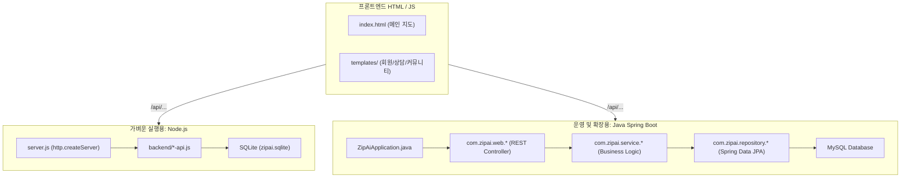

# ZipAI 백엔드 연동 및 기술 설계서 (개발자 분석용)

카카오 OAuth의 전체 처리 흐름, 관련 파일, DB 구조, 보안 처리와 환경별 활성화 방법은 [카카오 로그인 구현 안내](docs/kakao-login.md)에 별도로 정리되어 있습니다.

본 설계서는 **ZipAI (AI 기반 청년 주거 안전 플랫폼)**의 프론트엔드 화면(HTML)과 백엔드 시스템 간의 연동 구조, 사용 언어 및 기술 스택, 그리고 향후 고도화 시 화면별로 추가 적용해야 할 백엔드 기능을 분석하여 정리한 문서입니다.

---

## 한눈에 보는 백엔드 작업 완료 기능

> 아래 표는 아이디어나 향후 계획이 아니라 **현재 코드에 구현된 기능**을 정리한 것입니다. 외부 업체 연결이 필요한 기능은 현재 상태를 별도로 표시했습니다.

| 구분          | 작업한 기능                                      | 이 기능으로 할 수 있는 일                                                                    | 현재 상태                                                             |
| ------------- | ------------------------------------------------ | -------------------------------------------------------------------------------------------- | --------------------------------------------------------------------- |
| 회원 인증     | 이메일·SMS 인증번호 생성 및 검증                | 가입 또는 비밀번호 재설정 전에 사용자가 입력한 인증번호가 맞는지 확인                        | API 구현 완료. 이메일 SMTP와 SMS 업체 설정 전에는 실제 외부 발송 제한 |
| 계정 관리     | 회원정보 수정, 비밀번호 변경, 회원탈퇴           | 마이페이지에서 개인정보를 바꾸고 비밀번호를 변경하거나 계정을 탈퇴 처리                      | 구현 완료                                                             |
| 로그인 보안   | 로그인 시도 제한 및 계정 잠금                    | 비밀번호를 연속 5회 틀리면 계정을 15분 동안 잠가 무차별 대입 공격 방지                       | 구현 완료                                                             |
| 비밀번호 복구 | 인증번호 기반 비밀번호 재설정                    | 비밀번호를 잊은 사용자가 본인 인증 후 새 비밀번호 설정                                       | API 구현 완료. 실제 인증 메시지 발송은 외부 설정 필요                 |
| 마이페이지    | 본인 매물·문의·찜 목록 서버 연동               | 브라우저 한 곳에만 저장하던 정보를 서버에서 조회하여 다른 화면과 일관되게 관리               | 구현 완료                                                             |
| 관리자 통계   | 회원·문의·매물·방문 현황 집계                 | 오늘 가입자, 활성 회원, 신규/미답변 문의, 검토 대기 매물, 방문 대기 건수를 대시보드에서 확인 | 구현 완료                                                             |
| 통계 성능     | 통계 캐시와 주기적 갱신                          | 통계를 매 요청마다 다시 계산하지 않고 캐시하며 기본 60초마다 최신 상태로 갱신                | 구현 완료                                                             |
| 관리자 목록   | 검색·상태 필터·페이지네이션                    | 문의, 매물, 방문, 커뮤니티 자료를 조건별로 찾고 여러 페이지로 나누어 조회                    | 구현 완료                                                             |
| 관리자 처리   | 문의 답변 및 방문 승인·거절                     | 관리자가 문의에 답변하고 방문 요청을 승인하거나 거절                                         | 구현 완료                                                             |
| 게시글 관리   | 삭제 사유가 있는 소프트 삭제와 복구              | 커뮤니티 글을 DB에서 즉시 지우지 않고 숨긴 뒤 필요하면 복구                                  | 구현 완료                                                             |
| 감사 기록     | 관리자 작업 로그                                 | 매물 상태 변경, 문의 답변, 방문 처리, 게시글 삭제·복구 내역을 추적                          | 구현 완료                                                             |
| SMS 연동 준비 | 네이버 SENS 서명 및 발송 요청 코드               | 네이버 클라우드 키·서비스 ID·발신번호를 설정하면 실제 인증 문자 발송 가능                  | 코드 구현 완료, 현재`disabled`라 실제 발송 안 됨                    |
| PDF 안전 분석 | 등기사항증명서 PDF 문자 추출 및 위험 키워드 분석 | PDF에서 소유권·근저당·압류·가압류·경매·신탁 등의 표현을 찾아 페이지와 주변 문맥 표시    | 문자형 PDF 분석 구현 완료. 이미지 OCR 및 실제 공공기록 대조는 미구현  |
| 로컬 시연     | 원본과 분리된 H2 실행 환경                       | 운영 DB나 배포 서비스에 영향을 주지 않고 이 복사 폴더에서 로그인과 API 기능 확인             | 구현 및 기동 검증 완료                                                |

### 기능별 상세 설명

#### 1. 이메일·SMS 인증번호

- `POST /api/auth/verification/send`로 인증번호를 생성하고 발송 절차를 시작합니다.
- `POST /api/auth/verification/verify`로 사용자가 입력한 번호를 검증합니다.
- 네이버 SENS 연동 코드는 HMAC-SHA256 서명과 발송 요청까지 구현되어 있습니다.
- 현재 로컬 시연 환경은 `SMS_PROVIDER=disabled`이므로 실제 문자는 발송되지 않습니다. 실제 발송에는 네이버 클라우드 키, SENS 서비스 ID, 등록 발신번호와 유료 이용 설정이 필요합니다.

#### 2. 회원정보와 계정 관리

- `PATCH /api/account/profile`: 이메일, 전화번호 등 회원정보를 수정합니다.
- `PATCH /api/account/password`: 기존 비밀번호 확인 후 새 비밀번호로 변경합니다.
- `DELETE /api/account`: 사용자의 계정을 탈퇴 상태로 변경합니다.
- 마이페이지가 본인 매물, 문의, 찜 정보를 서버 API로 불러오므로 `localStorage`에만 의존하던 구조를 보완했습니다.

#### 3. 로그인 보안과 비밀번호 재설정

- 로그인 실패 횟수를 서버에 저장합니다.
- 연속 5회 실패하면 15분 동안 로그인을 차단하고, 정상 로그인하면 실패 횟수를 초기화합니다.
- `POST /api/auth/verification/reset-password`를 통해 인증을 마친 사용자가 새 비밀번호를 설정할 수 있습니다.
- 이 기능은 계정 공격을 줄여 주지만 CAPTCHA, IP 차단, 이상 로그인 탐지까지 포함한 것은 아닙니다.

#### 4. 관리자 대시보드와 통계 캐시

- `GET /api/admin/dashboard`에서 오늘 가입자, 활성 회원, 신규 문의, 미답변 문의, 검토 대기 매물, 방문 대기 건수를 제공합니다.
- 통계 결과를 캐시에 보관하고 기본 60초마다 갱신하여 반복 집계에 따른 DB 부담을 줄입니다.
- 갱신 간격은 `ADMIN_STATISTICS_REFRESH_MS` 설정으로 변경할 수 있습니다.

#### 5. 관리자 목록 조회와 업무 처리

- 문의와 커뮤니티 목록에는 서버 검색과 페이지네이션을 적용했습니다.
- 매물과 방문 요청 목록에는 상태 필터와 페이지네이션을 적용했습니다.
- 문의 답변은 실제 구현 규격인 `PATCH /api/admin/inquiries/{id}/answer`를 사용합니다.
- 관리자는 방문 요청을 승인 또는 거절하고, 매물의 검토 상태를 변경할 수 있습니다.

#### 6. 커뮤니티 소프트 삭제와 관리자 감사 로그

- 게시글 삭제 시 원문을 즉시 영구 제거하지 않고 삭제 상태와 사유를 기록합니다.
- 잘못 처리한 게시글은 관리자 복구 API로 다시 표시할 수 있습니다.
- 매물 상태 변경, 문의 답변, 방문 승인·거절, 게시글 삭제·복구 작업은 감사 로그로 남겨 누가 어떤 처리를 했는지 확인할 수 있습니다.

#### 7. 등기사항증명서 PDF 분석

- PDF 파일만 허용하며 파일 헤더, 암호화 여부, 최대 10MB 크기를 검사합니다.
- PDF에 포함된 문자에서 소유권, 근저당권, 채권최고액, 압류, 가압류, 경매, 신탁 관련 표현을 탐색합니다.
- 발견 결과에는 위험 단계, 발견 페이지와 주변 문맥을 함께 표시합니다.
- 이 분석은 위험 신호를 빠르게 확인하는 **보조 기능**이며 법적 판단이나 권리관계를 확정하지 않습니다.
- 스캔 이미지로만 구성된 PDF는 현재 읽을 수 없습니다. CLOVA OCR 같은 이미지 OCR 연결이 추가로 필요합니다.
- 인터넷에서 실제 최신 등기 기록을 자동 조회하거나 업로드 문서가 진본인지 검증하는 기능은 아닙니다. 최종 확인은 최신 등기사항증명서와 전문가 검토가 필요합니다.

#### 8. 원본과 분리된 로컬 시연 환경

- `local-demo` 프로필은 운영 MySQL 대신 `data/zipai-local.mv.db` H2 파일을 사용합니다.
- Git 원격 `origin`을 제거해 이 복사본에서 원본 GitHub로 실수로 push하는 것을 방지했습니다.
- 일반 회원 `demo / demo1234!`, 관리자 `admin / admin1234!` 계정을 자동 생성합니다.
- 다음 명령으로 실행한 뒤 `http://127.0.0.1:4173/index.html`에 접속합니다.

```powershell
.\gradlew.bat bootRun --no-daemon --args="--spring.profiles.active=local-demo"
```

### 아직 외부 연결이 필요한 기능

| 기능                   | 추가로 필요한 것                                              | 연결 전 상태                          |
| ---------------------- | ------------------------------------------------------------- | ------------------------------------- |
| 실제 SMS 발송          | 네이버 SENS 계정, API 키, 서비스 ID, 등록 발신번호, 요금 설정 | 발송 코드만 실행 준비 상태            |
| 실제 이메일 발송       | SMTP 서버 주소와 인증 정보                                    | 인증 API는 있으나 실제 메일 전송 제한 |
| 스캔 PDF OCR           | CLOVA OCR 등 이미지 OCR 서비스                                | 문자 레이어가 있는 PDF만 분석         |
| 최신 공공기록 대조     | 공식 조회 API 또는 허용된 데이터 제공처                       | 업로드된 PDF 내용만 분석              |
| 지도·기타 외부 데이터 | 각 서비스 API 키와 허용 도메인                                | 키가 필요한 부분은 제한될 수 있음     |

---

## 1. 백엔드 개발 환경 및 언어 (Backend Stack)

현재 ZipAI는 프로토타입 검증용 **Node.js 서버**와 실제 프로덕션 확장용 **Java Spring Boot 서버**가 공존하도록 구성되어 있습니다.



### 1) 가벼운 실행용: Node.js (JavaScript)

* **언어 및 환경**: JavaScript (ES6+), Node.js
* **특징**: 별도 프레임워크(Express 등) 없이 내장 HTTP 모듈로 경량 웹 서버([server.js](file:///c:/won/git/zipai/server.js))를 구현하여 정적 파일 서빙과 가벼운 API 라우팅을 처리합니다.
* **데이터베이스**: 파일 기반의 SQLite를 사용하며 `node:sqlite` 내장 모듈의 `DatabaseSync`로 처리합니다.

### 2) 운영 및 확장용: Java Spring Boot (Java)

* **언어 및 환경**: Java 21, Spring Boot 3.5.4, Gradle
* **특징**: JPA/Hibernate를 활용한 영속성 레이어 관리, Spring Security 기반의 사용자 인증/인가, Flyway를 이용한 MySQL 마이그레이션을 지원합니다.
* **데이터베이스**: 관계형 데이터베이스인 MySQL을 기반으로 설계되었습니다.

### 3) 생성된 백엔드 폴더 구조

현재 동작 중인 파일의 경로 호환성을 유지하면서, 신규 기능은 아래 구조에 맞춰 확장하도록 골격을 생성했습니다.

```text
zipai/
├─ backend/                         # 경량 API 및 AI 보조 서비스
│  ├─ README.md
│  ├─ auth.js                       # 현재 Node.js 인증 API
│  ├─ database.js                   # 현재 SQLite 접근 계층
│  ├─ *-api.js                      # 현재 기능별 Node.js API
│  ├─ node/                         # Node.js 계층형 확장 영역
│  │  ├─ config/                    # 환경 변수 및 외부 API 설정
│  │  ├─ controllers/               # 요청/응답 처리와 입력 검증
│  │  ├─ middleware/                # 인증·권한·오류·로깅
│  │  ├─ repositories/              # SQLite/외부 데이터 접근
│  │  ├─ routes/                    # API 경로 정의
│  │  └─ services/                  # 기능별 비즈니스 로직
│  └─ ai-service/                   # Python AI/OCR 독립 서비스
│     ├─ README.md
│     ├─ app/
│     │  ├─ api/                    # OCR·추천 HTTP 엔드포인트
│     │  ├─ core/                   # 설정·로깅·보안 공통 기능
│     │  ├─ schemas/                # 요청/응답 모델
│     │  └─ services/               # OCR 파싱·추천 알고리즘
│     └─ tests/                     # Python 서비스 테스트
├─ src/main/java/com/zipai/         # 운영용 Spring Boot 애플리케이션
│  ├─ config/                       # Spring 및 보안 기본 설정
│  ├─ domain/                       # JPA 엔티티
│  ├─ dto/                          # API 요청/응답 DTO
│  ├─ integration/                  # 공공 API·지도·S3·OCR·SMS 연동
│  ├─ repository/                   # Spring Data JPA 저장소
│  ├─ scheduler/                    # 실거래가 수집·알림·통계 작업
│  ├─ security/                     # JWT·OAuth2 인증/인가
│  ├─ service/                      # 비즈니스 로직
│  ├─ tools/                        # 운영 관리 CLI 도구
│  └─ web/                          # REST 컨트롤러·예외 처리
├─ src/main/resources/
│  ├─ application.yml              # 애플리케이션 설정
│  └─ db/migration/                 # Flyway DB 마이그레이션
└─ src/test/                        # Spring Boot 테스트
```

#### 구조 적용 원칙

1. 기존 `server.js`가 참조하는 `backend/*.js`는 즉시 실행 가능한 프로토타입이므로 이동하지 않습니다.
2. Node.js 기능을 고도화할 때는 `routes → controllers → services → repositories` 순으로 책임을 분리합니다.
3. OCR과 AI 추천은 `backend/ai-service`에서 독립 서비스로 구현하고, Spring Boot의 `integration` 계층을 통해 호출합니다.
4. Spring Boot 신규 API는 `web`, `service`, `repository`, `domain` 계층을 기본으로 하며 외부 서비스 호출은 `integration`에 격리합니다.
5. 실거래가 수집, 공고 매칭 알림, 관리자 통계 캐시는 `scheduler`에서 실행하고 실제 업무 규칙은 `service`에 둡니다.

---

## 2. 데이터베이스 테이블 구조 (Database Schema)

| 테이블명                           | 용도                         | 주요 컬럼                                                                                                                     |
| :--------------------------------- | :--------------------------- | :---------------------------------------------------------------------------------------------------------------------------- |
| **`users`**                | 가입 회원 정보               | `id`, `username`, `email`, `phone`, `password_hash`, `password_salt`, `role` (member, agent, admin), `status` |
| **`sessions`**             | 사용자 인증 세션 (Node.js용) | `token_hash`, `user_id`, `expires_at`, `created_at`, `last_seen_at`                                                 |
| **`properties`**           | 중개사 등록 매물 목록        | `id`, `owner_id`, `payload_json` (매물 정보), `status` (pending, approved, rejected, closed)                          |
| **`favorites`**            | 매물 찜(하트) 정보           | `user_id`, `property_id`, `created_at`                                                                                  |
| **`visit_requests`**       | 매물 방문 예약 스케줄        | `id`, `requester_id`, `room_id`, `room_title`, `visit_date`, `visit_time`, `phone`, `status`                  |
| **`room_offers`**          | 방 내놓기 제안 내역          | `id`, `owner_id`, `payload_json`, `status`                                                                            |
| **`community_posts`**      | 동네 리뷰 게시글             | `id`, `author_id`, `category` (review, tip, question, free), `title`, `content`, `area`, `rating`               |
| **`community_comments`**   | 게시글 댓글                  | `id`, `post_id`, `author_id`, `content`                                                                               |
| **`community_post_likes`** | 게시글 추천                  | `post_id`, `user_id`, `created_at`                                                                                      |
| **`inquiries`**            | 1:1 고객 문의 게시판         | `id`, `user_id`, `category`, `title`, `content`, `status`, `answer` (관리자 답변)                               |
| **`notifications`**        | 실시간 승인 및 알림 데이터   | `id`, `user_id`, `type`, `title`, `message`, `related_type`, `related_id`, `read_at`                          |

---

## 3. HTML 파일별 백엔드 연동 및 추가 적용 필요 기능 정리

각 화면의 특징에 맞는 **현재 구현 상태**와 **앞으로 추가로 적용해야 할 백엔드 기술 스택 및 비즈니스 로직**을 매핑한 결과입니다.

### 1) [index.html](file:///c:/won/git/zipai/index.html) (메인 매물 검색 및 지도) - 유준서

* **주요 기능**: 네이버 지도 기반 매물 탐색, 보증금/월세 조건별 다중 필터링, 일반/공공임대 탭 분리, 매물 찜 기능.
* **현재 연동 API**:
  * `GET /api/general-properties` (일반 매물 목록 조회)
  * `GET /api/public-housing` (LH 공공임대 API 중계)
  * `GET /PUT /api/favorites` (찜 목록 조회/갱신)
* **앞으로 적용해야 할 백엔드 기술 & 기능**:
  * **적용 언어/기술**: Java (Spring Boot) 또는 Node.js + Spatial Query (공간 쿼리)
  * **추가 적용 내용**:
    1. **공간 인덱싱 (Spatial Indexing) 도입**: MySQL의 `GEOMETRY` 타입과 `SPATIAL INDEX`를 적용해 지도 화면 확대/이동 시 현재 화면 영역 좌표 내의 매물을 0.001초 내에 빠르게 불러올 수 있도록 구현.
    2. **RPA 실거래가 배치 수집**: 국토교통부 실거래가 데이터 오픈 API를 주기적으로 수집하여 주변 적정 시세 가이드를 함께 제공하는 배치 로직 구축.

### 2) [login.html](file:///c:/won/git/zipai/templates/member/login.html) / [signup.html](file:///c:/won/git/zipai/templates/member/signup.html) / [mypage.html](file:///c:/won/git/zipai/templates/member/mypage.html) (회원 서비스) - 송성근

* **주요 기능**: 가입 및 로그인, 내 정보 및 찜 목록, 내가 올린 매물/방문 예약 이력 관리.
* **현재 연동 API**:
  * `POST /api/auth/signup` (가입) / `POST /api/auth/login` (로그인)
  * `GET /api/properties/mine` (본인 등록 매물 리스트 조회)
  * `GET /api/inquiries` (본인 1:1 문의 조회)
* **앞으로 적용해야 할 백엔드 기술 & 기능**:
  * **적용 언어/기술**: Java (Spring Boot / Spring Security) + JWT, OAuth 2.0 (소셜 로그인), Redis (캐시)
  * **추가 적용 내용**:
    1. **소셜 간편 로그인 연동**: 카카오, 네이버, 구글 OAuth2 API 컨트롤러 추가 연동.
    2. **JWT 기반 토큰 인증**: Access Token/Refresh Token 발급 구조로 변경하고, 분산 환경 및 API 게이트웨이 확장에 대비해 Redis에 토큰을 캐싱하여 관리.
    3. **이메일/SMS 본인 인증**: 가입 단계에서 본인 인증을 위한 SMTP 이메일 또는 외부 SMS 발송 API 탑재.

### 3) [charter-rate-calculator.html](file:///c:/won/git/zipai/templates/defense/charter-rate-calculator.html) / [checklist.html](file:///c:/won/git/zipai/templates/defense/checklist.html) / [fraud_result.html](file:///c:/won/git/zipai/templates/defense/fraud_result.html) (사기방지 및 종합 진단) - 송성근

* **주요 기능**: 전세가율 연산, 시기별 계약 안전성 체크리스트 수행, 점수화된 종합 분석 리포트 출력.
* **현재 연동 API**: 현재는 완전히 프론트엔드 자바스크립트의 로컬 연산으로 구동 중. (API 연동 없음)
* **앞으로 적용해야 할 백엔드 기술 & 기능**:
  * **적용 언어/기술**: Python (AI/OCR 처리 서버) + Java (Spring Boot) + Cloud Storage (AWS S3)
  * **추가 적용 내용**:
    1. **등기부등본 OCR 자동 인식 API**: 사용자가 등기부 이미지/PDF 업로드 시 OCR 모델(CLOVA OCR 등)을 경유하여 갑구의 신탁 여부, 을구의 근저당 채권최고액을 자동 파싱해 전세가율 계산기에 세팅하는 Python API 및 게이트웨이 구축.
    2. **진단 이력 영속화 및 공유 API**: 사용자가 자가진단을 완료하면 `POST /api/defense/reports`에 진단 스냅샷을 저장하고, 마이페이지에서 과거 이력을 조회하거나 고유 공유 URL을 생성할 수 있도록 영속화 처리.

### 4) [happy-housing.html](file:///c:/won/git/zipai/templates/board/happy-housing.html) (행복주택 자격 간편진단) - 윤태석

* **주요 기능**: 나이, 소득, 자산 요건 입력을 통한 청년 행복주택 입주 가능 여부 체크.
* **현재 연동 API**: 현재는 클라이언트 단의 조건문 연산으로 구동 중. (API 연동 없음)
* **앞으로 적용해야 할 백엔드 기술 & 기능**:
  * **적용 언어/기술**: Java (Spring Boot) 또는 Node.js + Rule Engine (판정 규칙 엔진)
  * **추가 적용 내용**:
    1. **법정 기준 요건 DB화 및 동적 비교**: 도시근로자 월평균 소득 기준, 주거급여 수급 기준 등 매년 개정되는 룰을 백엔드 DB에서 동적으로 읽어 판정하게 함으로써 유지보수 용이성 확보.
    2. **공고 매칭 알림 서비스**: 사용자가 등록한 소득/자산 정보를 기반으로 입주 가능한 신규 LH 모집 공고가 크롤링되면 회원 알림 테이블 및 SMS로 통보해 주는 푸시 시스템 연동.

### 5) [finance-policy.html](file:///c:/won/git/zipai/templates/board/finance-policy.html) / `trend*.html` (주거 금융 정책) - 김해원

* **주요 기능**: 버팀목 전세 대출, 월세 지원 등의 맞춤 정보 조회 및 상환 금액 실시간 계산.
* **현재 연동 API**: 현재 API 연동 없음.
* **앞으로 적용해야 할 백엔드 기술 & 기능**:
  * **적용 언어/기술**: Java (Spring Boot) 또는 Node.js + CMS 관리 API
  * **추가 적용 내용**:
    1. **정책 정보 관리 CMS**: 금융 정책 조건의 개정에 대응하여 백엔드 관리자 화면에서 실시간 추가/수정/삭제를 수행하고 프론트엔드로 내려주는 서빙 API 설계.
    2. **이자/상환 계획 연산 엔진**: 우대금리 옵션 및 원리금 균등/원금 균등 상환 방식별 납입 스케줄 결과 데이터를 생성하여 PDF로 전송하는 연산 라이브러리 연계.

### 6) [lifestyle-analysis.html](file:///c:/won/git/zipai/templates/ai/lifestyle-analysis.html) (방 구하기/내놓기 및 방문 예약) - 윤태석

* **주요 기능**: 중개사/임대인 대상 방 보기 예약 신청, 내 방 정보 업로드.
* **현재 연동 API**:
  * `GET /api/visits` / `POST /api/visits` (방문 예약 신청 및 조회)
  * `GET /api/room-offers` / `POST /api/room-offers` (내놓은 방 조회 및 등록)
* **앞으로 적용해야 할 백엔드 기술 & 기능**:
  * **적용 언어/기술**: Java (Spring Boot) + Redis (분산 락) + Python (AI 추천 모듈)
  * **추가 적용 내용**:
    1. **예약 중복 방지 동시성 제어**: 인기 있는 방문 예약 타임슬롯에 대한 동시 다발적 요청 시 정합성을 보장하기 위해 DB 비관적 락(Pessimistic Lock) 또는 Redis 분산 락을 설계.
    2. **AI 라이프스타일 추천 엔진**: 사용자가 설문 조사에 답변한 내용(통근 시간, 편의시설, 반려동물 가능 등)을 바탕으로 매물 데이터와 벡터 유사도를 분석하여 유사도가 가장 높은 상위 3개 매물을 챗봇 형태로 추천해주는 알고리즘 API.

### 7) [community.html](file:///c:/won/git/zipai/templates/board/community.html) / [community-detail.html](file:///c:/won/git/zipai/templates/board/community-detail.html) (동네 리뷰 및 커뮤니티) - 김해원

* **주요 기능**: 동네 장단점 공유 게시글 및 댓글 등록, 추천 수 조절.
* **현재 연동 API**:
  * `GET /POST /api/community/posts` (커뮤니티 글 조회 및 작성)
  * `GET /POST /api/community/posts/{id}/comments` (댓글 제어)
  * `PUT /api/community/posts/{id}/like` (게시글 추천)
* **앞으로 적용해야 할 백엔드 기술 & 기능**:
  * **적용 언어/기술**: Java (Spring Boot) 또는 Node.js + Cloud Object Storage (AWS S3)
  * **추가 적용 내용**:
    1. **AWS S3 이미지 업로드**: 커뮤니티 게시물에 방 사진이나 영수증 인증 사진을 첨부하기 위해 파일 업로드 모듈과 이미지 리사이징 배치 추가.
    2. **신고 기반 블라인드 처리**: 사용자 누적 신고 수가 일정 횟수를 넘을 시 게시판에서 즉시 가리고 관리자 검토 대기열로 상태를 전이하는 신고 트랜잭션 설계.

### 8) [admin.html](file:///c:/won/git/zipai/templates/admin/admin.html) (관리자 제어판) - 송성근

* **주요 기능**: 미승인 매물 심사 및 상태 승인/거절, 1:1 문의 답변 등록, 커뮤니티 삭제 관리.
* **현재 연동 API**:
  * `GET /api/admin/properties` / `PATCH /api/admin/properties/{id}/status`
  * `GET /api/admin/inquiries` / `POST /api/admin/inquiries/{id}/answer`
  * `GET /api/admin/community/posts` / `DELETE /api/admin/community/posts/{id}`
  * `PATCH /api/visits/{id}/approve` or `reject`
* **앞으로 적용해야 할 백엔드 기술 & 기능**:
  * **적용 언어/기술**: Java (Spring Boot) 또는 Node.js + Scheduler + Analytics (통계 분석 API)
  * **추가 적용 내용**:
    1. **통계 및 대시보드 API**: 당일 가입한 활성 회원 수, 신규 접수된 문의 건수, 매물 검토 대기 건수 등의 지표를 실시간 통계로 집계하고, 성능 향상을 위해 주기적 캐싱 처리하여 제공하는 대시보드 API 구현.

### 9) [safety.html](file:///c:/won/git/zipai/templates/safe/safety.html) (위험안전도 분석) - 이훈경

* **주요 기능**: 지역 안전, 범죄 주의구간, 여성 밤길, 치안시설, 비상벨, CCTV 등의 데이터를 종합하여 지역별 안전 점수를 지도상에 시각화하고 상세 등급 렌더링.
* **현재 연동 API**: 현재는 지도 핀 및 지역 정보가 프론트엔드 마크업과 모의 데이터로 하드코딩되어 작동 중. (API 연동 없음)
* **앞으로 적용해야 할 백엔드 기술 & 기능**:
  * **적용 언어/기술**: Java (Spring Boot) 또는 Node.js + Public Safety Open API (행정안전부/지자체 공공 API)
  * **추가 적용 내용**:
    1. **위치 주소 검색 및 좌표 변환 API**: 사용자가 주소를 검색창에 입력하면 Naver/Kakao Geocoding API를 경유하여 위도, 경도 좌표를 획득하는 주소 변환 기능 연계 (`GET /api/safe/geocode`).
    2. **치안 안전 데이터 조회 API**: 검색한 좌표 기준 및 설정 반경(500m, 1km 등) 내에 설치된 CCTV, 가로등, 비상벨, 지구대 등의 위치 정보를 DB에서 실시간 조회하여 목록화하는 API 설계 (`GET /api/safe/infrastructure`).
    3. **종합 안전도 평가 알고리즘**: 생활안전지도 정보, 5대 범죄 발생 이력, 치안시설 밀도 등의 빅데이터를 결합해 알고리즘 기반 100점 만점의 청년 주거 안전 등급 점수를 산정하여 리턴하는 스코어링 API 구현 (`GET /api/safe/score`).

---

## 2026-08-24 네이버 SENS SMS 및 등기사항증명서 PDF 분석 구현

요청한 두 가지 백엔드 기능인 **네이버 SENS 문자 발송 준비**와 **등기사항증명서 PDF 위험 요소 분석**을 구현했습니다.

### 1. 네이버 SENS SMS 인증 기능

#### 작업한 기능

- 네이버 SENS Signature V2 생성 로직을 구현했습니다.
- HMAC-SHA256으로 API 요청 서명을 생성하고 네이버 SENS SMS API에 실제 발송 요청을 보낼 수 있도록 구현했습니다.
- 현재 기본값은 `SMS_PROVIDER=disabled`이므로 외부 문자가 실제로 발송되지는 않습니다.
- 나중에 SENS 키, 서비스 ID와 등록 발신번호를 환경변수에 입력하고 `SMS_PROVIDER=naver-sens`로 변경하면 코드 수정 없이 실제 발송을 활성화할 수 있습니다.

#### 인증번호 보안 및 사용 제한

| 제한 항목         | 적용 내용        | 목적                                            |
| ----------------- | ---------------- | ----------------------------------------------- |
| 동일 번호 재발송  | 번호당 1분에 1회 | 짧은 시간 동안 반복 발송되는 문자 남용 방지     |
| 번호별 일일 발송  | 하루 최대 5회    | 한 전화번호에 대한 과도한 발송과 비용 발생 방지 |
| 서비스 전체 발송  | 하루 최대 100회  | 시연 중 전체 SMS 비용과 오남용 제한             |
| 인증번호 유효시간 | 발급 후 5분      | 오래된 인증번호 재사용 방지                     |
| 인증번호 입력     | 최대 5회         | 인증번호 무작위 추측 방지                       |

#### 이 기능으로 할 수 있는 것

- 회원가입 또는 비밀번호 재설정 과정에서 전화번호 인증번호를 생성할 수 있습니다.
- SENS 설정이 완료되면 생성된 인증번호를 사용자의 휴대전화로 실제 전송할 수 있습니다.
- 사용자가 입력한 인증번호의 일치 여부와 만료 여부를 서버에서 확인할 수 있습니다.
- 반복 발송과 반복 입력을 제한하여 시연 중 문자 비용과 인증번호 공격 위험을 줄일 수 있습니다.

#### 구현 파일

- SMS 발송 구현: [`NaverSensSmsSender.java`](src/main/java/com/zipai/service/NaverSensSmsSender.java)

#### 실제 발송 활성화에 필요한 환경변수

- `SMS_PROVIDER=naver-sens`
- `NCP_ACCESS_KEY`
- `NCP_SECRET_KEY`
- `NCP_SENS_SERVICE_ID`
- `NCP_SMS_FROM`: 네이버 SENS에 등록된 발신번호

> 현재는 SENS 계정과 인증 정보를 연결하지 않은 상태이므로 실제 문자 발송 검증은 보류했습니다. 코드와 제한 로직은 구현되어 있습니다.

### 2. 등기사항증명서 PDF 분석 기능

#### 작업한 기능

- 로그인한 사용자가 등기사항증명서 PDF를 업로드할 수 있는 분석 API를 구현했습니다.
- 최대 파일 크기를 10MB로 제한했습니다.
- 파일 확장자만 확인하지 않고 PDF 형식과 파일 헤더를 함께 검사합니다.
- 암호화되어 내용을 읽을 수 없는 PDF는 분석을 차단합니다.
- 업로드한 PDF는 메모리에서 분석하며 서버 디스크에 영구 저장하지 않습니다.
- PDF에서 추출한 문자를 바탕으로 다음 위험 관련 항목을 탐지합니다.

| 탐지 항목  | 사용자가 확인할 수 있는 위험 신호                   |
| ---------- | --------------------------------------------------- |
| 신탁       | 소유권 또는 처분 권한을 별도로 확인해야 할 가능성   |
| 압류       | 채권자가 재산 처분을 제한한 기록 가능성             |
| 가압류     | 확정 판결 전 재산을 임시로 보전한 기록 가능성       |
| 가처분     | 처분 또는 권리행사를 임시로 제한한 기록 가능성      |
| 경매       | 부동산 강제 매각 절차가 진행 중이거나 기록된 가능성 |
| 근저당     | 담보 채무와 채권최고액을 확인해야 하는 항목         |
| 전세권     | 다른 전세권자의 권리와 순위를 확인해야 하는 항목    |
| 임차권등기 | 기존 임차인의 보증금 반환 문제가 있었을 가능성      |

- 위험 표현을 발견하면 발견된 PDF 페이지와 주변 원문을 함께 표시합니다.
- 위험 키워드가 발견되지 않더라도 해당 부동산이 안전하다고 판정하지 않습니다.
- 화면에서 AI 분석이 할 수 있는 일과 할 수 없는 일을 구분해 안내합니다.
- 분석 결과가 최신 권리변동이나 법적 안전성을 보장하지 않는다는 경고를 표시합니다.
- 사용자가 주의사항에 동의해야만 PDF 분석을 요청할 수 있도록 했습니다.

#### 이 기능으로 할 수 있는 것

- 사용자가 긴 등기사항증명서를 처음부터 모두 읽기 전에 주의해서 볼 표현을 빠르게 찾을 수 있습니다.
- 위험 표현이 어느 페이지의 어떤 문맥에 있는지 확인할 수 있습니다.
- AI 분석 결과를 계약 결정이 아닌 1차 확인 자료로 이용할 수 있습니다.
- 스캔 PDF처럼 분석할 수 없는 문서는 임의로 결과를 추측하지 않고 OCR 연결이 필요하다고 안내받을 수 있습니다.

#### AI 분석이 할 수 없는 것

- 인터넷이나 등기소에서 실제 최신 등기 기록을 자동으로 조회하지 않습니다.
- 업로드된 문서가 위조되지 않은 진본인지 확인하지 않습니다.
- 권리의 우선순위, 실제 채무 잔액 또는 계약의 법적 안전성을 확정하지 않습니다.
- 법률 전문가, 공인중개사 또는 최신 등기사항증명서 확인을 대신하지 않습니다.
- 현재는 문자를 선택할 수 있는 PDF만 분석합니다. 이미지로 스캔된 PDF의 글자 인식에는 CLOVA OCR 같은 별도 OCR 공급자 연결이 필요합니다.

#### 관련 파일

- PDF 분석 서비스: [`RegistryDocumentAnalysisService.java`](src/main/java/com/zipai/service/RegistryDocumentAnalysisService.java)
- PDF 업로드 API: [`DefenseAnalysisController.java`](src/main/java/com/zipai/web/DefenseAnalysisController.java)
- 분석 화면: [`fraud_result.html`](templates/defense/fraud_result.html)
- 화면 연동 JavaScript: [`registry-analysis.js`](static/js/registry-analysis.js)

### 3. 검증 결과

- Java 전체 소스 컴파일 성공
- 테스트 소스 컴파일 성공
- 신규 JavaScript 문법 검사 성공
- 실제 SMS 전송은 SENS 계정과 키가 없어 보류
- 기존 테스트 보고서가 다른 프로세스에 열려 있어 `clean` 작업만 실패했지만, 전체 소스 재컴파일은 정상 완료

---

## 2026-08-24 백엔드 로컬 시연 환경 구성

원본 프로젝트의 GitHub, Netlify, Render 및 운영 데이터에 영향을 주지 않고 이 복사 폴더에서 백엔드 기능을 확인할 수 있도록 독립적인 로컬 시연 환경을 구성했습니다.

### 구현 및 설정 내용

- 복사 폴더의 Git 원격 저장소 `origin`을 제거하여 원본 GitHub 저장소로 실수로 push할 수 없도록 분리했습니다.
- Spring Boot 전용 `local-demo` 프로필을 추가했습니다.
- 운영 MySQL/Render 데이터베이스 대신 파일형 H2 데이터베이스를 사용하도록 설정했습니다.
- 로컬 데이터는 `data/zipai-local.mv.db`에 저장되며 운영 데이터에는 접근하지 않습니다.
- H2 데이터 파일을 `.gitignore`에 등록하여 Git 추적 대상에서 제외했습니다.
- JPA가 직접 관리하지 않는 `favorites`, `community_post_likes` 테이블을 로컬 실행 시 생성하도록 별도 스키마를 추가했습니다.
- 최초 실행 시 시연용 일반 회원과 관리자 계정을 자동 생성하는 초기화 로직을 추가했습니다.
- SMS 연동용 코드는 유지하되 `local-demo` 환경에서는 공급자를 비활성화하여 실제 문자가 발송되지 않도록 했습니다.
- 한글과 문장부호가 포함된 Windows 복사 경로에서 발생하던 Gradle 증분 컴파일 문제를 방지하도록 Java 증분 컴파일을 비활성화했습니다.

### 실행 방법

프로젝트 루트의 PowerShell에서 다음 명령을 실행합니다.

```powershell
.\gradlew.bat bootRun --no-daemon --args="--spring.profiles.active=local-demo"
```

실행 완료 후 다음 주소로 접속합니다.

```text
http://127.0.0.1:4173/index.html
```

Live Server만 사용하면 정적 화면만 제공되므로 로그인, 회원 데이터, 관리자 대시보드 등 백엔드 API가 필요한 기능은 동작하지 않습니다.

### 시연용 계정

| 권한      | 아이디    | 비밀번호       |
| --------- | --------- | -------------- |
| 일반 회원 | `demo`  | `demo1234!`  |
| 관리자    | `admin` | `admin1234!` |

### 검증 결과

- Java 전체 컴파일 성공
- `local-demo` 프로필의 Spring Boot 서버 기동 성공
- `GET /api/health` 정상 응답 확인
- 관리자 계정 로그인 성공
- `GET /api/admin/dashboard` 정상 응답 확인
- 로컬 H2 데이터베이스 파일 생성 및 Git 제외 확인
- Git 원격 저장소가 제거되어 원본 저장소와 분리된 상태 확인

### 제한 사항

- 실제 SMS 발송은 외부 SMS 업체의 인증 정보와 요금제 연결 전까지 동작하지 않습니다.
- 실제 이메일 발송은 별도의 SMTP 서버 설정이 필요합니다.
- 지도, AI 및 공공 기록 실시간 조회처럼 외부 API에 의존하는 기능은 해당 API 키와 서비스 연결이 있어야 완전하게 동작합니다.
- 서버를 종료하려면 실행 중인 PowerShell에서 `Ctrl+C`를 누릅니다. 로컬 H2 데이터는 서버를 다시 실행해도 유지됩니다.

---

## 2026-08-26 부족 기능 및 보안 보강 작업

| 영역        | 작업한 기능                          | 사용자가 할 수 있는 일                                | 상태                         |
| ----------- | ------------------------------------ | ----------------------------------------------------- | ---------------------------- |
| 가입 보안   | 본인 인증 필수화                     | 이메일 또는 휴대폰 인증을 완료한 뒤 회원가입          | 완료                         |
| 인증번호    | 1회 소비 처리                        | 이미 가입·재설정에 사용한 인증번호 재사용 차단       | 완료                         |
| 세션        | 로그인·가입 시 세션 ID 교체         | 세션 고정 공격 위험 감소                              | 완료                         |
| 비밀번호    | 영문·숫자·특수문자 필수            | 단순한 비밀번호 사용 방지                             | 완료                         |
| 연락처      | 변경 연락처 재인증                   | 본인 소유를 확인한 이메일·전화번호로만 변경          | 완료                         |
| 관리자      | 누락 통계·검색·페이지 UI           | 활성 회원·방문 대기 확인, 문의 검색과 페이지 이동    | 완료                         |
| 게시글 관리 | 삭제 목록·복구 UI                   | 소프트 삭제된 게시글을 조회하고 복구                  | 완료                         |
| 운영 추적   | 감사 로그 UI                         | 관리자 주요 작업 기록 확인                            | 완료                         |
| 진단 이력   | 저장·목록·상세 API                 | PDF 분석 결과를 계정별로 보관하고 마이페이지에서 조회 | 완료                         |
| 진단 공유   | 임의 토큰 공유·해제                 | 추측하기 어려운 링크용 토큰으로 결과 공유             | 완료                         |
| OCR 구조    | `integration/ocr` CLOVA 클라이언트 | 키 연결 시 스캔 PDF 문자를 인식                       | 코드 완료, 실제 키 검증 필요 |

DB 변경은 `V3__verification_consumption_and_defense_reports.sql`에 구성했고, 신규 Java 코드는 기존 구조에 맞춰 `domain`, `repository`, `service`, `web`, `integration/ocr`로 분리했습니다.

검증 결과 Java·테스트 소스 컴파일과 변경 JavaScript 문법 검사가 성공했으며, 로컬 서버에서 인증 필수 가입, 진단 저장·조회·공유, 관리자 로그인·통계 API를 직접 확인했습니다. 전체 Gradle 테스트 실행은 소스 실패가 아니라 현재 폴더명에 포함된 한글과 쉼표로 인한 Windows 테스트 작업자 `ClassNotFoundException` 때문에 완료되지 않았습니다.

실제 SMS·SMTP·CLOVA OCR과 OAuth는 외부 계정 및 키가 필요합니다. JWT·Refresh Token·Redis는 현재 세션 기반 화면과 API 전체를 동시에 바꾸는 별도 인증 마이그레이션 범위이므로 이번 보강에서는 기존 정상 동작을 유지했습니다.

---

## 2026-08-26 사용자 피드백 반영 수정

| 문제                                 | 원인 또는 기존 상태                                                                | 수정 결과                                                         |
| ------------------------------------ | ---------------------------------------------------------------------------------- | ----------------------------------------------------------------- |
| 작성한 게시글이 다시 들어오면 사라짐 | 작성 직후에는 브라우저 배열로 표시됐지만 재조회 시 지연 로딩 작성자 접근 오류 가능 | 게시글 목록 조회를 읽기 트랜잭션으로 묶어 DB 게시글이 반복 조회됨 |
| 진단 이력을 클릭할 수 없음           | 목록과 공유 버튼만 존재                                                            | 행 전체 상세 보기와 당시 탐지 결과·근거 문맥 표시                |
| 업로드 원본을 다시 볼 수 없음        | 개인정보 보호를 위해 파일을 즉시 폐기                                              | 원본 PDF를 AES-GCM 암호화 저장하고 본인 전용 다운로드 제공        |
| 공유 기능이 불필요                   | 마이페이지에 공유 토큰 버튼 노출                                                   | 공유 UI 제거, 결과·원본 다운로드로 교체                          |
| 회원정보 화면의 목적이 불명확        | 마이페이지 내부에 인증·저장·탈퇴 폼이 동시에 노출                                | 회원정보 전용`account.html`로 분리하고 연락처 변경 시에만 인증  |
| 탈퇴 비밀번호가 처음부터 노출        | 기본 마이페이지 폼에 입력란 존재                                                   | 확인 대화상자를 거친 뒤 비밀번호 입력, 완료 후 감사 안내          |
| 상단 검색 버튼이 동작하지 않음       | 버튼에 클릭 이벤트가 없음                                                          | 메인 매물 검색란으로 이동·포커스하도록 공통 인증 스크립트에 연결 |

신규 DB 변경은 `V4__defense_report_original_file.sql`에 추가했습니다. 원본 파일 저장 키는 운영 환경에서 반드시 `REPORT_FILE_KEY`로 별도 설정해야 하며 키를 잃으면 암호화된 파일을 복호화할 수 없습니다.

진단 다운로드 API는 본인 세션과 소유권을 확인합니다. `GET /api/defense/reports/{id}/download/result`는 저장된 결과를, `GET /api/defense/reports/{id}/download/original`은 복호화된 원본 PDF를 반환합니다. 기존 기록 중 원본 저장 기능 추가 전에 생성된 기록은 결과만 조회할 수 있습니다.

---

## 2026-08-26 마이페이지·알림·문의 연동 보강

| 기능           | 기존 문제                                       | 보강 결과                                                                                  |
| -------------- | ----------------------------------------------- | ------------------------------------------------------------------------------------------ |
| 내 활동        | 건수만 표시되고 클릭 불가                       | 실제`/api/properties/mine`, `/api/inquiries`, `/api/visits` 응답을 목록·상세로 표시 |
| 문의 후속 처리 | 문의 답변을 자세히 보거나 이어서 문의할 수 없음 | 원문·답변 상세 확인 및 이전 문의 번호를 포함한 추가 문의 작성 지원                        |
| 찜 목록        | 빈 서버 목록에 브라우저 예시 3건을 다시 저장    | 로그인 사용자는`/api/favorites`의 실제 서버 목록만 사용                                  |
| 알림           | 미확인 건수만 표시                              | `/api/notifications` 목록 패널, 개별 읽음, 모두 읽음 연결                                |
| 고객센터       | 문의 행과 내역 바로가기가 없음                  | 상단 내역 카드 및 클릭 가능한 문의 상세 대화상자 추가                                      |

추가 문의는 기존 문의를 변경하지 않고 새로운 문의로 저장하므로 과거 질문과 답변 이력이 유지됩니다. 별도 DB 구조 변경 없이 기존 API와 데이터의 호환성을 유지했습니다.

---

## 2026-08-27 방 구하기 찜 목록 연동 수정

| 문제                  | 원인                                                | 수정 결과                                                   |
| --------------------- | --------------------------------------------------- | ----------------------------------------------------------- |
| 고정 매물 4개 표시    | `lifestyle-analysis.js`에 예시 매물이 직접 선언됨 | 예시 제거 후 로그인 계정의`/api/favorites` 전체 목록 사용 |
| 찜 개수 불일치        | 메인 화면의 상세 캐시에서 일부 매물을 제외          | 공공매물을 포함한 모든 찜 ID와 상세 정보를 보관             |
| 원하는 매물 선택 불가 | 네 개 고정 카드를 직접 선택하는 구조                | 전체 찜 선택 목록에서 원하는 매물을 선택                    |
| 이미지가 없음         | 아이콘만 출력                                       | 메인 매물 화면과 같은 대표 이미지 표시                      |
| 여러 카드 동시 표시   | 2열 고정 카드 목록                                  | 선택한 매물 한 개만 카드로 표시                             |

서버의 찜 ID를 기준으로 하므로 찜 개수는 마이페이지와 동일하게 계산됩니다. 매물 상세 캐시가 없는 오래된 기록도 ID를 누락하지 않고 표시하며, 메인 매물 찾기를 다시 열면 상세 정보와 대표 이미지가 갱신됩니다.

### 2026-08-27 방문 승인 권한 보강

방문 화면을 로그인 역할에 따라 분리했습니다. 일반 회원은 `GET /api/visits`를 통해 본인 신청 내역과 승인 결과만 확인하며 승인·거절 제어가 표시되지 않습니다. 관리자는 `GET /api/admin/visits`로 전체 요청을 확인하고 기존 `PATCH /api/visits/{id}/approve|reject` 기능을 사용할 수 있습니다.

검증 결과 일반 회원의 관리자 목록 API 접근은 HTTP 403, 관리자 접근은 성공했습니다. 프론트엔드에서도 관리자 역할일 때만 승인·거절 버튼을 생성하고 이벤트를 처리합니다.

## 2026-08-27 방문 예약 생명주기 구현

| 영역        | 구현 내용                                                                              |
| ----------- | -------------------------------------------------------------------------------------- |
| 사용자 제어 | 본인 예약 취소, 일정 변경 요청, 처리 사유·관리자 안내 확인                            |
| 관리자 제어 | 승인, 거절, 방문 완료, 노쇼, 관리자 취소 및 상태 필터                                  |
| 상태 보안   | 현재 상태에 허용된 다음 처리만 가능하고 완료 후 취소 같은 역방향 변경 차단             |
| 일정 검증   | 찜한 실제 매물만 허용, 최소 2시간 이후·최대 90일, 09~20시 정각, 사용자 중복 예약 방지 |
| 처리 기록   | 사유, 사용자 안내, 비공개 관리자 메모, 처리자·처리·완료 시각 저장                    |
| 알림        | 승인 결과 알림 및 24시간·1시간 전 스케줄 알림                                         |
| 개인정보    | 관리자 목록 연락처 마스킹, 상세 연락처 조회 감사 로그                                  |

추가 API는 `GET /api/visits/{id}`, `PATCH /api/visits/{id}/cancel`, `PATCH /api/visits/{id}/reschedule`, `GET /api/admin/visits/{id}`이며 기존 관리자 처리 API는 `approve`, `reject`, `complete`, `no-show`, `cancel` 상태 전이를 지원합니다. 운영 DB용 변경은 `V5__visit_reservation_lifecycle.sql`입니다.

실제 서비스 안내 문구는 사용자 요청대로 `실제 서비스에서는 매물담당자(매물등록자 혹은 담당공인중개사)가 방문가능여부 및 일정을 확인합니다.`로 표시했습니다. 방문 후기·결과 설문은 요청 범위에서 제외했습니다.

## 2026-08-27 알림 대상 상세 연결

기존 알림 API가 반환하는 `relatedType`과 `relatedId`를 프론트엔드 상세 패널에 연결했습니다. 알림 항목을 클릭하면 읽음 처리와 함께 처리 내용·발생 시각을 표시하고 다음 대상 화면으로 이동할 수 있습니다.

| `relatedType`    | 연결 화면                        |
| ------------------ | -------------------------------- |
| `inquiry`        | 고객센터 해당 문의 상세          |
| `visit`          | 방 구하기·내놓기 해당 방문 예약 |
| `property`       | 매물 찾기 해당 매물 상세         |
| `defense_report` | 마이페이지 해당 진단 기록        |

대상 ID는 URL 쿼리로 전달되며 각 페이지에서 본인 권한으로 서버 데이터를 조회한 뒤 해당 항목을 자동으로 표시합니다.

## 2026-08-27 마이페이지 방문·방 내놓기 현황 연동

마이페이지가 기존 매물·문의·방문 건수에 더해 `GET /api/room-offers`를 호출하고, 방문 신청과 방 내놓기 등록 현황을 상세 목록으로 제공합니다. 방문 기록은 전체 생명주기 상태와 사용자 공개 안내만 표시하며 비공개 관리자 메모는 노출하지 않습니다. 모든 조회 API는 로그인 세션의 사용자 ID로 소유권 범위를 제한합니다.

## 2026-08-27 방문 예약 서버 요청 실패 원인 및 보강

| 구분        | 내용                                                                                                                            |
| ----------- | ------------------------------------------------------------------------------------------------------------------------------- |
| 원인 1      | 기존 로컬 H2의`visit_requests` 테이블에 방문 처리 사유·메모·처리 시각·알림 시각 컬럼이 없었습니다.                         |
| 원인 2      | Hibernate가 기존 데이터가 있는 테이블에 기본값 없는`NOT NULL` 컬럼을 추가하려다 실패했습니다.                                 |
| 원인 3      | 예전 방 내놓기 신청의`payload_json` 일부가 JSON 객체가 아닌 이중 인코딩된 JSON 문자열이어서 목록 변환 중 오류가 발생했습니다. |
| 수정        | 로컬 스키마에 기본값을 가진 멱등적 컬럼 추가 구문을 넣고, 현재/구형 JSON 형식을 모두 읽는 변환 로직을 적용했습니다.             |
| 데이터 보호 | H2 파일과 기존 예약·신청 행을 삭제하거나 초기화하지 않았습니다.                                                                |
| 검증        | 데모 로그인 200,`GET /api/visits` 200, `GET /api/room-offers` 200을 확인했습니다.                                           |

## 2026-08-27 게시판 영속 조회 오류 보강

게시글 생성 API는 글을 DB에 정상 저장하고 있었습니다. 문제는 `CommunityController`가 목록 응답을 만들 때 사용한 `Map.entry`가 `NULL` 값을 허용하지 않는다는 점이었습니다. 초기 데이터 중 지역 등 선택 항목이 비어 있는 게시글 하나를 변환하는 순간 `NullPointerException`이 발생하여 목록 API 전체가 500을 반환했습니다.

응답 생성을 `LinkedHashMap` 기반의 null-safe 변환으로 변경했습니다. 문자열 선택값은 빈 문자열로 정규화하고, 수정 시각이 없으면 생성 시각을 사용하며, 사용자 표시값이 비어 있는 경우에도 나머지 게시글 조회가 계속됩니다. 기존 DB 데이터는 삭제하지 않았습니다.

검증 결과 데모 계정으로 로그인한 뒤 `GET /api/community/posts`를 두 번 연속 호출했고, 두 요청 모두 HTTP 200과 동일한 게시글 4건을 반환했습니다. 사용자가 방금 작성한 최신 게시글도 DB 목록에서 확인했습니다.

## 2026-08-27 전체 백엔드 500 오류 감사

### 추가로 발견하고 수정한 오류

| 기능                      | 원인                                                                           | 수정 결과                                                       |
| ------------------------- | ------------------------------------------------------------------------------ | --------------------------------------------------------------- |
| 관리자 감사 로그          | 과거 로그의 nullable 값을 null을 허용하지 않는`Map.of`로 응답 변환           | `LinkedHashMap` 기반 null-safe 변환, 목록 HTTP 200            |
| 방문 예약 상세            | 과거 예약의 사용자 연관 객체 ID를 직접 역참조하여`NullPointerException` 발생 | `findByIdAndRequesterId` 소유권 조건 조회 적용, 상세 HTTP 200 |
| 방문 예약 취소·일정 변경 | 상세과 동일한 직접 역참조 방식 사용                                            | 동일한 DB 소유권 조건 조회로 선제 보강                          |

### 전체 점검 결과

- 정상 조회: 건강 상태, 로그인 상태, 일반 매물, 내 매물, 찜, 문의, 방문, 방 내놓기, 알림, 게시판, 진단 이력
- 정상 관리자 조회: 대시보드, 매물, 문의, 방문, 게시글, 삭제 게시글, 감사 로그
- 정상 상세/파일: 문의 상세, 방문 상세, 게시글 상세·댓글, 진단 상세, 진단 결과 JSON, 암호화 보관 원본 PDF
- 권한 검증: 비로그인 보호 API 401, 일반 회원의 관리자 API 접근 403
- 입력 검증: 잘못된 생성 요청 400, 잘못된 회원 비밀번호 401, 미인증 요청 403, 없는 게시글 404
- 화면 자원: HTML 25개 HTTP 200
- JavaScript: 자체 스크립트 24개 `node --check` 통과
- 서버 오류: 점검 대상 실제 API에서 수정 후 HTTP 500 없음
- 외부 의존성: 공공주택 API는 로컬에서 외부 키·연결이 없으면 의도된 HTTP 503

Gradle 테스트 소스 컴파일은 성공하지만, 현재 한글과 문장부호가 포함된 복사 폴더 경로에서 Gradle 테스트 작업이 생성된 테스트 클래스를 다시 찾지 못하는 환경 문제가 남아 있습니다. 이 문제는 애플리케이션 API의 500 오류와는 별개이며, 최신 서버를 직접 기동한 세션 기반 스모크 테스트로 기능 응답을 검증했습니다.
## 2026-09-04 3가지 회원가입·로그인 방식

| 방식 | 동작 |
| --- | --- |
| ZipAI 자체 계정 | 기존 아이디·이메일·휴대폰·비밀번호 및 본인 인증 가입, 아이디·비밀번호 로그인 유지 |
| 카카오 | OAuth 인가 코드 → 토큰 교환 → 카카오 사용자 정보 확인 → 최초 자동 가입 또는 기존 계정 연결 → ZipAI 세션 로그인 |
| 구글 | OAuth/OIDC 인가 코드 → 토큰 교환 → Google UserInfo 확인 → 최초 자동 가입 또는 기존 계정 연결 → ZipAI 세션 로그인 |

### 보안 및 데이터 구조

- 인가 요청마다 예측하기 어려운 UUID `state`를 생성하여 서버 세션에 저장하고 콜백에서 공급자까지 일치하는지 검증합니다.
- 클라이언트 시크릿과 토큰 교환은 브라우저가 아니라 Spring Boot 서버에서만 처리합니다.
- 공급자 액세스·리프레시 토큰은 데이터베이스에 저장하지 않습니다.
- `oauth_identities(provider, provider_subject)`에 고유 제약조건을 두어 동일 소셜 계정의 중복 가입을 방지합니다.
- 소셜 ID는 별도 테이블에서 `users`와 연결하므로 한 ZipAI 계정에 카카오와 구글을 함께 연결할 수 있습니다.
- 검증된 이메일이 기존 활성 계정과 일치하면 새 회원을 중복 생성하지 않고 소셜 로그인 수단을 연결합니다.
- 카카오 이메일을 받지 못한 경우 공급자 고유 ID로 내부 전용 이메일을 만들어 계정을 유지합니다.
- OAuth 설정이 없는 환경은 공급자 버튼 비활성화 및 HTTP 503으로 처리되어 기존 로컬 실행과 자체 로그인을 방해하지 않습니다.

### API

- `GET /api/auth/oauth/providers`: 카카오·구글 설정 가능 여부
- `GET /api/auth/oauth/kakao/start`
- `GET /api/auth/oauth/kakao/callback`
- `GET /api/auth/oauth/google/start`
- `GET /api/auth/oauth/google/callback`

운영 MySQL 변경은 `V6__oauth_identities.sql`, 로컬 H2 변경은 `local-demo-schema.sql`에 적용했습니다. 필요한 환경 변수는 `PUBLIC_BASE_URL`, `KAKAO_CLIENT_ID`, `KAKAO_CLIENT_SECRET`, `GOOGLE_CLIENT_ID`, `GOOGLE_CLIENT_SECRET`이며 `.env.example`에도 추가했습니다.

로컬 콜백 주소는 카카오 `http://127.0.0.1:4173/api/auth/oauth/kakao/callback`, 구글 `http://127.0.0.1:4173/api/auth/oauth/google/callback`입니다. 배포 시에는 `PUBLIC_BASE_URL`과 개발자 콘솔 등록 주소를 실제 HTTPS 도메인으로 함께 변경해야 합니다.

검증 결과 Java 컴파일과 리소스 처리, 관련 JavaScript 문법 검사가 성공했습니다. 키 미설정 상태에서 공급자 상태 200·시작 요청 503·자체 로그인 200을 확인했고, 시험 설정에서는 두 공급자의 인가 URL 302 응답에 등록 콜백과 CSRF `state`가 포함되는 것을 확인했습니다. 실제 카카오·구글 사용자 인증은 각 개발자 콘솔에서 발급한 키를 설정한 뒤 최종 확인해야 합니다.

## 2026-09-14 사기방지 데이터 사용자 격리 보강

| 대상 | 기존 문제 | 보강 내용 |
| --- | --- | --- |
| 계약 체크리스트 | 모든 방문자가 같은 `localStorage` 키를 사용하여 이전 사용자의 답변이 표시될 수 있음 | 로그인 필수 적용, 사용자 ID별 초안·결과 키 사용, 기존 공용 키 제거 |
| 계약가이드 | 완료 단계가 브라우저 전체 사용자에게 공유됨 | 로그인 필수 적용, 사용자 ID별 완료 단계 저장 |
| 안전진단 결과 | 체크리스트 결과가 공용 키에서 조회됨 | 현재 로그인 사용자의 결과만 조회 |
| 전세가율 결과 | 저장 결과가 안전진단에 공용으로 반영됨 | 로그인 사용자별 결과 키로 저장·조회 |
| 로그인 이동 | 보호 화면 접근 후 로그인하면 메인으로 이동 | 요청한 보호 화면 경로를 세션에 보관하고 로그인 후 복귀 |

사용자별 키 형식은 `기능키:{사용자ID}`이며, 비로그인 상태에서는 개인화된 체크·계산 데이터를 읽거나 기록하지 않습니다. 처음 이용하는 계정은 체크리스트와 가이드가 모두 초기 상태로 표시되고, 이후에는 해당 계정 자신의 진행 내용만 유지됩니다.

검증 결과 `common.js`, `checklist.js`, `guide.js`, `result.js`, `calculator.js`, `login.js`의 JavaScript 문법 검사가 모두 통과했습니다.

## 2026-09-17 공통 푸터 간소화

- 헤더·카테고리와 중복되는 푸터 CTA, 사이트맵, 안전 체크리스트 바로가기를 표시하지 않도록 변경했습니다.
- 브랜드·고객센터·공공기관 링크·사업자 및 약관 정보는 유지했습니다.
- 공통 `footer.css`의 데스크톱/모바일 레이아웃과 간격을 압축하여 푸터 높이가 기존 대비 약 절반 수준이 되도록 조정했습니다.
- 백엔드 API와 데이터 구조에는 변경이 없으며 모든 푸터 사용 페이지에 공통 적용됩니다.

## 2026-09-21 로컬 카카오 OAuth 설정 도구

- `ZipAI-Kakao-Setup.bat`과 `scripts/configure-local-kakao.ps1`을 추가했습니다.
- 로컬 카카오 REST API 키와 Client Secret은 `.runtime/zipai-local-oauth.json`에 저장되며 `.runtime/`은 `.gitignore`에서 제외됩니다.
- `scripts/start-local-demo.ps1`은 서버 시작 전에 해당 파일을 읽고 `PUBLIC_BASE_URL`, `KAKAO_CLIENT_ID`, `KAKAO_CLIENT_SECRET`을 현재 Spring Boot 프로세스 환경에만 적용합니다.
- 설정 이후 서버를 완전히 재시작하면 `/api/auth/oauth/providers`의 `kakao` 값으로 적용 여부를 확인할 수 있습니다.

## 2026-09-29 카카오 OAuth 백엔드 구현 상세 기록

### 서버 처리 순서

1. `GET /api/auth/oauth/kakao/start`가 카카오 REST API 키 설정 여부를 검사합니다.
2. 서버가 UUID `state`를 만들고 공급자 이름과 함께 `HttpSession`에 저장합니다.
3. `response_type=code`, REST API 키, 콜백 주소와 `state`가 포함된 카카오 인가 URL로 HTTP 302 응답을 보냅니다.
4. 카카오가 `GET /api/auth/oauth/kakao/callback`으로 `code`와 `state`를 전달합니다.
5. `SocialLoginService`가 세션의 `state`와 공급자 이름을 검증합니다.
6. 서버가 `https://kauth.kakao.com/oauth/token`에 인가 코드, REST API 키, Client Secret과 콜백 주소를 전달해 액세스 토큰을 발급받습니다.
7. 발급받은 토큰으로 `https://kapi.kakao.com/v2/user/me`를 호출하여 카카오 고유 ID와 동의받은 프로필을 확인합니다.
8. `oauth_identities(provider, provider_subject)`를 조회하여 기존 연결이면 해당 회원을 사용하고, 없으면 회원 생성 또는 검증 이메일 기반 기존 회원 연결을 수행합니다.
9. `AuthService.establishSession`으로 ZipAI 로그인 세션을 만든 뒤 메인 화면으로 리다이렉트합니다.

### 데이터 및 계정 정책

| 조건 | 백엔드 처리 |
| --- | --- |
| 신규 카카오 고유 ID | `users`와 `oauth_identities` 행 생성 |
| 기존 소셜 연결 | 연결된 `users` 행으로 로그인 |
| 검증 이메일이 기존 활성 회원과 일치 | 기존 회원 ID를 소셜 ID에 연결 |
| 이메일을 받지 못함 | `kakao+{고유ID}@oauth.zipai.invalid` 형태의 내부 이메일 사용 |
| 동일 공급자·고유 ID 재등록 | DB 고유 제약조건으로 차단 |
| 회원 상태가 `active`가 아님 | HTTP 401 성격의 로그인 거부 처리 |

카카오 비밀번호, 액세스 토큰, 리프레시 토큰은 데이터베이스에 저장하지 않습니다. 사용자의 실제 카카오 인증은 카카오 도메인에서 이루어집니다.

### 보안 처리

- 로그인 요청마다 새로운 `state`를 만들고 콜백에서 일치 여부를 검사하여 로그인 CSRF를 방지합니다.
- 콜백 공급자가 세션에 저장된 공급자와 같은지도 함께 확인합니다.
- Client Secret은 소스 코드가 아니라 환경변수 또는 Git 제외 로컬 설정에서만 주입합니다.
- 카카오가 유효하고 검증됐다고 전달한 이메일만 기존 회원 자동 연결에 사용합니다.
- 설정이 없는 환경에서는 버튼을 비활성화하고 시작 API는 HTTP 503을 반환하여 기존 자체 로그인을 유지합니다.

### 설정값과 주소

```text
PUBLIC_BASE_URL
KAKAO_CLIENT_ID
KAKAO_CLIENT_SECRET
```

- Render 기준 `PUBLIC_BASE_URL`: `https://zipai-jb4z.onrender.com`
- Render 콜백: `https://zipai-jb4z.onrender.com/api/auth/oauth/kakao/callback`
- 로컬 기준 `PUBLIC_BASE_URL`: `http://127.0.0.1:4173`
- 로컬 콜백: `http://127.0.0.1:4173/api/auth/oauth/kakao/callback`

카카오 Developers에서는 카카오 로그인 활성화, REST API 키, Client Secret 활성화, 닉네임·이메일 동의항목 및 정확한 Redirect URI를 설정해야 합니다. 로컬 키는 `ZipAI-Kakao-Setup.bat`으로 입력하며 `.runtime/zipai-local-oauth.json`에 저장됩니다.

### 상태 확인과 주요 오류

- `GET /api/auth/oauth/providers`: `kakao: true`이면 키 적용 완료
- `KOE004`: 카카오 로그인 활성화 여부 확인
- `KOE006`: 카카오 Developers의 Redirect URI와 `PUBLIC_BASE_URL` 기반 콜백 주소 비교
- 로컬에서만 `false`: 설정 저장 후 실행 중인 Java 서버를 완전히 종료하고 재시작
- 동의 후 실패: REST API 키와 Client Secret의 종류·활성화 상태 및 서버 로그 확인

상세 파일 목록과 추후 보강 범위는 [카카오 로그인 구현 안내](docs/kakao-login.md)를 참고합니다.
